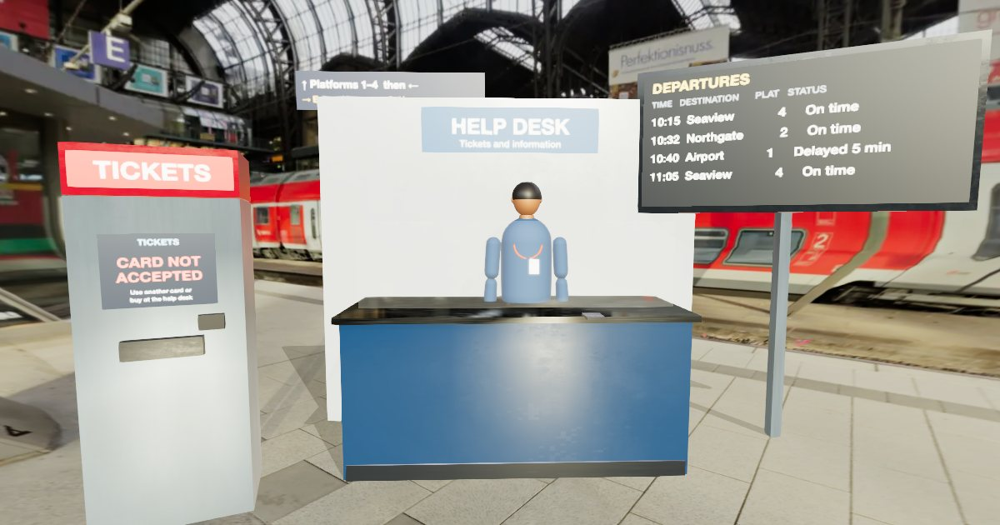

> **Evaluation status:** Automated functional, accessibility and performance testing plus agent-based design reviews are complete. No real learners have tested this yet. No physical phone testing has been done (mobile was checked with device emulation). See `evaluation/METHODS.md`.

# Arrival: a task-based English game (A2 to B1)

You've just arrived in a new English-speaking city. Buy a transit ticket, order food with a dietary need, ask a
pharmacist for help, and fix a hostel booking problem, using English to get real things done.

**Play now:** https://immersive-learning-showcase.vercel.app/play/arrival-english/ (available once v1.0.0 is pinned in the showcase; pending deployment)



## Trailer

**Trailer:** [docs/trailer.webm](docs/trailer.webm) (53 s, captioned; WebVTT sidecar at [docs/trailer.vtt](docs/trailer.vtt)).

## Problem

Learners at A2 often know the words but freeze in real service encounters: a machine that rejects a card, a
sold-out dish, a pharmacist's follow-up questions, a booking that "isn't there". They need transactional
language, repair strategies and a feel for tone, and they rarely get to try a blunt or wrong answer safely
and see what happens.

## Audience

Adult and older-teen English learners at about CEFR A2 working towards B1 (newcomers, international students,
travellers), for self-study or before a speaking lesson. About 30-40 minutes. Teachers: see
[design/teacher-guide.md](design/teacher-guide.md).

## Approach

Task-based language teaching: each of the four tasks has a **pre-task** (a captioned model exchange, 5-6 key
chunks, quick matching), the **task** (a branching conversation in a realistic 3D place) and a **post-task**
(results, better ways to say it, and new phrasebook entries).

| Task | Place (fictional Harbour City) | Goal | Twist |
|---|---|---|---|
| 1 | Station help desk | The right ticket + directions | The ticket machine rejects your card |
| 2 | Café counter | Lunch for you and a friend with a nut allergy | A dish is sold out; two alternatives contain nuts |
| 3 | Pharmacy counter | Describe a sore throat; check the instructions | Follow-up questions (language practice only, not medical advice) |
| 4 | Hostel reception | Check in | Your booking is missing; negotiate a different room or date |

- **Three ways to answer:** *choose* (3-4 options: effective, grammatical but pragmatically odd, a common learner
  error), *build* from chunk tiles (keyboard operable; several correct orders accepted), or *speak* (optional,
  off by default, approximate key-phrase check).
- **The NPC reacts** to what you say through posture and gesture (nod, folded arms, shrug, point), and the panel
  explains why, with a recast.
- **Repair always available:** "Sorry, could you repeat that?", "More slowly, please", "Could you spell that, please?", "Listen again".
- **Assessment without AI:** task success, effective-choice rate and repairs per task; an 8-item listening check
  (transcripts after answering); Leitner spaced review of the phrasebook; a can-do self-assessment before and after.
- **No AI, no API keys, no server.** Everything is authored JSON in [content/](content/) and stays on the learner's device.

## Key design decisions

Full list with alternatives in [DECISIONS.md](DECISIONS.md).

- Authored branching dialogue (predictable, level-appropriate, every branch tested) instead of an LLM.
- Pragmatically odd distractors, because real communication fails on tone as well as grammar.
- Odd and wrong answers still reach the goal; the reaction and feedback carry the consequence (low anxiety).
- Speech input off by default, with a disclosure that some browsers send audio to the vendor's speech service.
- **Deviation:** stylized procedural NPCs instead of MakeHuman figures (exports were not obtainable in the build
  environment). They are mid-distance, with no faces and no lip sync, and react only through posture.
- One HTML task panel serves both 3D mode and text mode, so the two cannot drift apart.

## Realism and cinematics: design rationale

Realism is used where the detail is a learning cue: **readable signage** (the departures board, a menu with
allergen notes and a SOLD OUT line, the product box's dosage, the booking screen) and a photographic sense of
place from CC0 Poly Haven photo HDRIs of a real station, café, shop and lobby. The backdrops are slightly blurred and
desaturated so the foreground reads first (signaling). NPCs are kept mid-distance and stylized; there are no crowds
and no decorative motion during tasks, because extraneous detail and decorative animation can add cognitive load,
and technology can raise language anxiety through overload (Huang & Liu, 2025). VR studies show benefits for
vocabulary, listening and productive skills in context-rich environments (Sun & Song, 2025; Şimşek et al., 2026),
but this is desktop and mobile 3D, so that evidence is indirect. Cinematics total 50 s (six cinematics, seven shots, all skippable
and captioned, still frames under reduced motion). See [design/realism-matrix.md](design/realism-matrix.md) and
[design/shot-list.md](design/shot-list.md); sources in [research/sources.md](research/sources.md).

## CEFR alignment

Objectives are informed by verbatim CEFR Companion Volume (2020) descriptors from *Obtaining goods and services*,
*Information exchange*, *Asking for clarification*, *Monitoring and repair*, *Overall oral interaction* and
*Understanding announcements and instructions*, with page numbers, in
[design/cefr-alignment.md](design/cefr-alignment.md). The game does not certify a level.
English variety: British spelling with neutral vocabulary ([design/english-variety.md](design/english-variety.md)).

## Evidence and evaluation

See [evaluation/METHODS.md](evaluation/METHODS.md). In summary: dialogue validator (4 graphs, 68 nodes, 97 options, 0 errors);
54 unit tests; Playwright functional tests including a scripted run of the whole game, keyboard-only completion and
**every option of every node** answered in the real UI; axe with 0 critical or serious issues across the main UI states;
a sub-path build test; budget measurements (first load about 3 MB, 121 draw calls or fewer); and a language-level check
against the Cambridge A2 / B1 vocabulary lists ([research/language-level.md](research/language-level.md)).
No learners have used it, and no learning gains are claimed.

## Accessibility: play it your way

- **Text mode:** every task as an illustrated dialogue with the same choices, feedback and phrasebook (header button, or automatic without WebGL).
- **Deaf or hard of hearing:** text first; NPC reactions written out; a reading-equivalent listening path (documented as an alternative, not equivalent listening practice).
- **Captions** always (the conversation text is always on screen); **speech rate 0.75-1.25x**; voice choice; mute.
- **Keyboard:** everything, including the tile builder (Enter or Space); "Look at" buttons instead of dragging the camera.
- **Reduced motion:** follows the OS setting or the toggle in Settings.
- **Text size, high contrast, field of view, quality presets** (Low / Medium / High / Ultra, auto-selected).
- **No timers.** Details: [design/accessibility-plan.md](design/accessibility-plan.md). Full WCAG conformance would need manual testing with assistive technologies.

## Privacy

Progress, phrasebook and settings are stored in this browser under `arrival-english:` keys only. Menu → My progress
shows the record and lets you download it as JSON or clear it. Nothing is sent anywhere by the game. Speech input
uses the browser's own recognition; in some browsers that sends audio to the browser vendor.

## System requirements and known limitations

- A current Chrome, Edge, Firefox or Safari; WebGL2 for 3D (text mode works without it). Desktop first; phones are supported (portrait layout).
- Speech input only works where the browser supports SpeechRecognition; voice output quality depends on the device's voices.
- No ambient sound in v1.0.0. NPCs are stylized, not photoreal. Real signage in the backdrop photos is blurred, not removed.
- Frame rate has not been measured on real GPUs or phones in this repo.

## Next steps

Learner playtests (templates in [evaluation/human-protocol/](evaluation/human-protocol/)), human ESL-teacher review,
MakeHuman figures if exports become available, optional CC0 ambience, and more tasks (bank, doctor's appointment).

## Run it locally

```bash
npm ci
npm run dev                   # http://localhost:5174
npm test                      # unit tests (vitest)
VITE_TEST_HOOKS=1 npm run build && npx playwright test tests/functional.spec.js tests/a11y.spec.js
npm run build && SLUG=arrival-english npx playwright test tests/sub-path.spec.js
npm run validate:dialogues    # graph checks (also run before every build)
node scripts/readability-check.mjs
```

Assets: `node scripts/process-assets.mjs` downloads the CC0 sources into `data/raw/` (gitignored) and regenerates `src/assets/`.
Poster and text-mode stills: `VITE_TEST_HOOKS=1 npm run build && node scripts/render-poster.mjs && npm run build`.

## Tools

three.js 0.186.1, Vite 8.3.5, postprocessing 6.39.5, n8ao 2.0.1, Playwright 1.64.1, axe-core 4.14, vitest 5.0.5,
ImageMagick, poppler `pdftotext`. Browser Web Speech API (no keys).

## License

Code: MIT ([LICENSE](LICENSE)). Content (dialogue, chunks, docs): CC BY 4.0 ([LICENSE-CONTENT](LICENSE-CONTENT)).
Third-party assets are CC0; see [ATTRIBUTION.md](ATTRIBUTION.md). All people, places and products in the game are fictional,
and the dialogue is constructed for teaching purposes.
